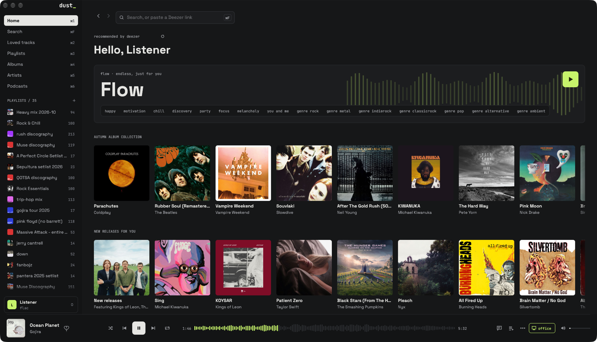
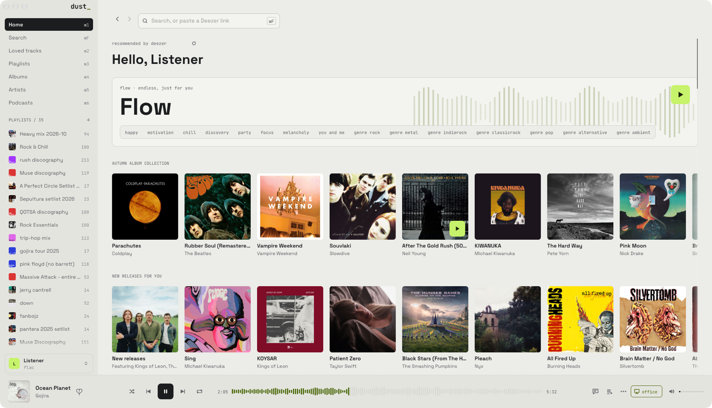

<p align="center"></p>

# dust

**A free and open source, ultra-lightweight desktop music player written in Rust, for
your streaming service and your own library — Deezer and Navidrome today — with
AirPlay 2 streaming built in.**

[](https://github.com/domknez/dust/actions/workflows/ci.yml)
[](LICENSE)


<p align="center">
  
  
</p>

dust is free software: free to use, study, modify and share under the [MIT license](LICENSE).
No ads, no telemetry, no account with us — bring a Deezer subscription, your own
Navidrome (or other Subsonic) server, or both, and switch between them in one click.
Inspired by [SpotLight](https://github.com/dddevid/SpotLight).

| | dust | Deezer desktop |
|---|---|---|
| Binary | ~10 MB | 300+ MB |
| Memory, idle in background | ~85 MB | 400+ MB |
| Memory, idle and visible | ~155 MB¹ | |
| Idle CPU | ~0% (UI sleeps when untouched) | |

¹ About half of that is the window's own drawing buffers, which macOS keeps for every
visible window (they scale with window size on Retina displays); dust itself uses ~70–85 MB,
including cover art.

## Music sources

dust is one player for several music sources. Each source brings its own catalogue,
library and login; everything else — the player, queue, AirPlay, lyrics, mini player,
the look — is shared. Pick the source from the account card at the bottom of the
sidebar (*Music from*); each keeps its own queue, and dust starts with the one you used
last. More sources can be added later without changing the rest of the app.

| | Deezer | Navidrome / Subsonic |
|---|---|---|
| **You need** | Deezer Premium | your own [Navidrome](https://www.navidrome.org) (or Subsonic / OpenSubsonic) server |
| **Home** | your recommendations, Flow and its moods, daily mixes, mixes inspired by tracks | *Radio* (endless, from the whole library or one genre), recently added / played, most played, favourites, mixes per artist |
| **Library** | Loved tracks, playlists, albums, followed artists, podcasts | starred songs as *Loved tracks*, playlists, the whole library under *Albums* and *Artists* |
| **Playlists** | create, add, remove, rename, delete | create, add, remove, rename, delete |
| **Likes** | tracks, albums, artists | stars |
| **Search** | tracks, artists, albums, playlists, podcasts; paste a Deezer link | tracks, artists, albums |
| **Lyrics** | synced | synced or plain, from the server |
| **Audio** | MP3 128 / 320 or FLAC (FLAC needs HiFi) | MP3, FLAC, AAC/ALAC, Ogg Vorbis, WAV as they are; other formats converted by the server |
| **Listening reports** | history, Flow learning and Last.fm through Deezer | play counts and "now playing" on the server (and Last.fm / ListenBrainz if it scrobbles) |

You can use dust with only one of them: the login screen offers *Log in with Deezer*
and *Connect a Navidrome server*.

## Features

**Player** (every source)

- **Queue:** see what's next, jump to any track, reorder by dragging, remove, clear;
  it survives a restart (paused where you left off);
  right-click any track or card → *Play next* / *Add to queue*
- **Endless play:** Deezer's Flow and the server's Radio keep going, fetching more as you
  listen
- **Seeking** on a waveform-style progress bar
- **Lyrics:** the lyrics button in the player bar opens the playing track's lyrics; synced
  ones follow the song with the sung line highlighted, and clicking a line jumps there
- **Shuffle and repeat** (all or one) in the player bar; both are remembered between runs
- **Sleep timer:** in the player bar's ⋯ menu, with a countdown ring; after 15 minutes
  to an hour the music fades out over 30 seconds and pauses (your volume is back for
  the next play), or it stops at the end of the track (the next one waits for play)
- **Artist pages:** popular tracks and the full discography, plus related artists; click
  any artist name to get there
- **Streamed, not stored:** audio is decoded on the fly — nothing is written to disk

**Listening anywhere**

- **AirPlay 2 and AirPlay 1** output with automatic discovery and a *Play on* picker that shows each speaker's
  model and the playing one's volume — Sonos (incl. Era 100/300),
  HomePod-class receivers, Apple TV, AirPort Express, shairport-sync and most AirPlay speakers
- **Speaker buttons work:** volume and play/pause/skip on the speaker control dust
- **Plays steadily in the background:** while music plays, macOS doesn't nap dust or
  idle-sleep the Mac, and the audio threads run at high priority
- **Media keys and Now Playing:** keyboard and headset media keys, plus the system's
  Now Playing controls with cover art (macOS Control Center, Windows media overlay,
  Linux MPRIS)
- **Mini player**: a borderless always-on-top strip with cover, title, artist and the
  speaker it plays on, controls and a progress line along the bottom; drag it anywhere,
  make it narrower for just the title, times and play, double-click the cover to go back

**The app**

- **Modern UI ("Graphite"):** clean and crisp, a charcoal dark and a soft grey light theme
  (or follow the system) with one lime accent, Space Grotesk text and titles and
  JetBrains Mono for labels, times and counts
- **Updates itself**: new versions download and verify in the
  background; then *Restart to update* appears in the sidebar (or the update installs
  when you quit)
- **Secure sign-in:** logins are kept in the OS keychain (macOS Keychain, Windows
  Credential Manager, Secret Service), all in one item, so the keychain asks for access
  once
- Runs on macOS, Linux and Windows

**Deezer**

- **Home like Deezer's:** your personalised recommendations — Flow and its moods
  (Chill, Focus, Workout, Party, ...), daily mixes, mixes inspired by tracks you play,
  recently played, new releases, artists and albums picked for you
- **Plays more of the catalogue:** when a track isn't licensed in your region, dust uses
  the alternative version Deezer offers, like the web app does
- **Podcasts:** find shows in Search and play their episodes (newest first, with dates);
  the podcasts you follow on Deezer are under *Podcasts* in the sidebar
- **Links:** paste a Deezer link (album, artist, playlist, track, or a share link) into
  Search to open it
- **Synced with your account:** likes, follows and playlists, plus listening history and
  Last.fm scrobbling exactly like Deezer's own apps

**Navidrome / Subsonic**

- **Connect:** account card → *Music from* → *Navidrome · Connect a server…* (or the link
  on the login screen). Enter the server's address (e.g. `http://192.168.1.10:4533`),
  your user name and password; dust checks them before saving. The password is sent to
  the server only as a salted token (Subsonic token authentication), never in plain text
- **Radio:** Home opens with endless random songs from the whole library or from one of
  its biggest genres (the genre chips), in place of Deezer's Flow
- **Your files as they are:** MP3, FLAC, AAC/ALAC (M4A), Ogg Vorbis and WAV at any sample
  rate; anything else (Opus, WMA, ...) is converted to MP3 320 by the server as it plays.
  Seeking jumps straight into MP3s and converted files; other formats skip ahead from
  the start (quick on a home network)
- **Plays reported to the server** (play counts, "now playing"); Navidrome passes them on
  to Last.fm and ListenBrainz if you linked them there
- **Trying it without a server:** `scripts/navidrome-test-server.sh` starts a throwaway
  Navidrome in Docker with a few generated test tones (user `dust`, password
  `dust-test-pw`), and `DUST_TEST_SUBSONIC="http://127.0.0.1:4533|dust|dust-test-pw" cargo
  test subsonic::live -- --ignored` runs the live checks against it

## Install

Download the latest version for your platform from
[Releases](https://github.com/domknez/dust/releases/latest): a DMG for macOS 11+ (Apple
Silicon and Intel), a zip for Windows 10/11, and tarballs for Linux x86_64 and ARM64.
You need Deezer Premium, a Navidrome / Subsonic server, or both.

- **macOS:** drag dust to Applications. Releases aren't notarized by Apple yet, so the
  first launch is blocked: open dust once, then click **Open Anyway** under System
  Settings → Privacy & Security. After an update macOS may ask once more before dust can
  read its saved login; choose **Always Allow**.
- **Windows:** unzip and run `dust.exe`; on a SmartScreen warning choose
  **More info → Run anyway**.
- **Linux:** unpack and run `./dust` (needs WebKitGTK 4.1, ALSA and D-Bus; the archive
  includes a `.desktop` entry and icon).

Later versions install themselves from inside dust. On Windows and
Linux that needs dust's folder to be writable by you (e.g. `~/.local/bin`); otherwise
the update button opens the download page.

## Build

```sh
cargo build --release
./target/release/dust
```

On macOS, run `scripts/dev-cert.sh` once and build with `scripts/build.sh`: it signs
builds with a local "dust dev" identity so Keychain stops asking for access after every
rebuild. `scripts/bundle-macos.sh` builds the universal `dust.app` and DMG into `dist/`.

Releases:

- **Merging a pull request into `main` releases it.** The Auto release workflow bumps
  the minor version, moves the CHANGELOG's *Unreleased* notes under it (or uses the PR
  title), commits, and tags; the tag starts the Release workflow. PR labels:
  `release:patch`, `release:major`, or `no-release` to merge without releasing.
- **Direct pushes to `main` don't release.** To release by hand:
  `scripts/bump-version.py minor` (or `patch`, `major`, `0.5.0`), commit, then
  `git tag v<version> && git push origin main v<version>`.

The Release workflow builds every platform and publishes the GitHub Release. Adding the
Apple secrets listed in `.github/workflows/release.yml` makes it sign with a Developer ID
and notarize.

Linux needs ALSA, D-Bus and WebKitGTK headers:
`sudo apt install libasound2-dev libdbus-1-dev libwebkit2gtk-4.1-dev pkg-config`.
Without the login window (no WebKitGTK): `cargo build --release --no-default-features`.

## Sign in

**Deezer:** click **Log in with Deezer**: a small window shows deezer.com's own login
page (OS webview, private session). Once you are signed in, dust picks up the session
and closes it. The session token (`arl` cookie) is stored in your OS keychain; **Log out
of Deezer** in the account menu removes it. Deezer Premium required. Email/password
sign-in works; Google and Apple sign-in may refuse embedded browsers.

Fallback: "Paste ARL cookie instead" takes the `arl` value from a logged-in browser
(DevTools → Application → Cookies). Treat it like a password; "Log out of all devices"
in Deezer's account settings revokes it.

**Navidrome / Subsonic:** *Connect a Navidrome server* on the login screen, or account
card → *Music from* → *Navidrome*. The address, user name and password are kept in the
OS keychain; **Disconnect from Navidrome** in the account menu removes them.

## Settings

Click your name at the bottom of the sidebar:

- **Appearance:** System, Dark or Light
- **Streaming quality** (Deezer): MP3 128, MP3 320 or FLAC
- **Listening reports:** *Share listening with Deezer* (history, Flow and Last.fm
  scrobbling) or *Report plays to the server*, for the source in use (on by default)
- **Updates**: check automatically (on by default), or check now

dust also remembers your **volume** and your **speaker**: the last AirPlay speaker you
picked is selected again automatically once it appears on the network (it only connects
when you press play).

The update check asks GitHub's public releases API for the latest version at startup
and every 6 hours; nothing about you or your listening is sent. Turn it off with
**Check automatically** and dust contacts only your music sources and your speakers.

Choices are saved in `settings.conf` in your config directory
(`~/Library/Application Support/dust` on macOS, `%APPDATA%\dust` on Windows,
`~/.config/dust` on Linux).
Each source's queue is saved next to it (`queue.json` for Deezer, `queue-navidrome.json`
for the server) and comes back paused when dust starts.

dust keeps a log of playback and AirPlay events (tracks opened and how long that took,
speaker connections, flushes, packet stats) for troubleshooting: Settings → **Show
log file**. It lives in `~/Library/Logs/dust/dust.log` on macOS,
`%LOCALAPPDATA%\dust\dust.log` on Windows and `~/.local/state/dust/dust.log` on Linux,
stays on your computer and is started over beyond 5 MB (the previous one is kept as
`dust.log.1`).

## Last.fm scrobbling and listening history

dust reports what you listen to the source it came from, and nowhere else:

- **Deezer:** each listen (how long you listened, whether you skipped), the same way
  Deezer's apps do. Deezer uses that for your listening history, "Recently played" and
  Flow recommendations and, if you've connected Last.fm in your Deezer account settings,
  scrobbles it to Last.fm.
- **Navidrome / Subsonic:** "now playing" and a play once a track is heard through (or
  for four minutes). The server keeps play counts and "Recently played"; Navidrome
  scrobbles to Last.fm and ListenBrainz if you linked them in its settings — don't also
  scrobble elsewhere, or plays count twice.

Turn it off in Settings (*Share listening with Deezer* / *Report plays to the server*).

## AirPlay

Pick a speaker from the AirPlay button next to the volume slider. Expect about 2 s of
latency, the same as other AirPlay senders.

- **AirPlay 2** receivers (most speakers from recent years, e.g. Sonos Era): dust pairs
  transiently (HomeKit, no PIN), encrypts control and audio, and runs a small PTP clock
  that the speaker follows. PTP uses UDP ports 319/320: fine without root on macOS and
  Windows; on Linux grant `CAP_NET_BIND_SERVICE`
  (`sudo setcap cap_net_bind_service=+ep target/release/dust`), otherwise dust falls back
  to NTP timing, which many AirPlay 2 speakers accept but won't play.
- **AirPlay 1** receivers with unencrypted audio (`et=0`) use the classic RAOP path.
- Not supported yet: receivers that need an AirPlay password or PIN pairing.

Speaker hardware buttons reach dust through DACP (an mDNS-advertised remote-control
service), so volume changes on the speaker move dust's slider.

Check an output without logging in:

```sh
dust --list-speakers                       # speakers found on the network (silent)
dust --check-update                        # is a newer release out, can this copy install it
dust --tone                                # 4 s test tone on the local sound card
DUST_LOG=debug dust --tone "Living Room"   # ...on an AirPlay speaker, with packet stats
```

## Troubleshooting

`DUST_LOG=debug` (or `info`, `trace`) prints diagnostics to the terminal, e.g. AirPlay
packet stats, speaker remote-control requests, media keys and listen reports.

`DUST_DISPLAY_NAME="Listener"` shows that name instead of your Deezer account's, for
screenshots.

With a stored Deezer session (log in with the app first), these check the Deezer side
without opening the window:

```sh
dust --debug-home                          # home page sections
dust --debug-search "daft punk"            # search results
dust --debug-link <deezer url>             # what a pasted link opens
dust --debug-decode <playlist id> flac 60  # decrypt and decode 10 s from 0:60, silently
```

## Shortcuts

- `Space`: play/pause
- `⌘F` / `Ctrl+F`: search
- `⌘1`–`⌘6` / `Ctrl+1`–`Ctrl+6`: Home, Loved tracks, Playlists, Albums, Artists, Podcasts
- `⌘←` / `⌘→` (`Alt+←` / `Alt+→` on Windows and Linux), or the mouse's side buttons:
  back / forward between pages
- `⌘⇧M` / `Ctrl+Shift+M`: mini player on/off
- `⌘,` / `Ctrl+,`: Settings (`Esc` closes them)
- Double-click a track, or click its number: play from there
- Home cards: click to open, click the lime play button to play right away
- Right-click a track: *Play next*, *Add to queue*, *Add to playlist ›* (and *Remove
  from this playlist* on your own); right-click a card or playlist: *Play next* /
  *Add to queue*; album and playlist pages have *Add to queue* and a ⋯ menu (*Add all
  to playlist*, *Rename*, *Delete*)
- Queue panel → *Save*: the queue as a new playlist; sidebar → *+*: a new playlist
- Click *PLAYLISTS* in the sidebar to fold the list away (or bring it back); dust
  remembers it
- Queue button (next to AirPlay): open the queue; drag rows to reorder

## Project structure

```
src/
├── main.rs            entry point: run the app, or a command-line mode (cli.rs)
├── log.rs             DUST_LOG levels, log macros and the log file
├── deezer/            Deezer client: session, catalogue, streaming, listen reports, stream cipher;
│                      models.rs holds the data types every source fills
├── subsonic/          Navidrome / Subsonic client: token auth, catalogue, likes, playlists, streams
├── provider.rs        the source in use (Deezer or a server) behind one interface
├── player/            playback engine thread, queue (pure, tested), decoding, listen tracking
├── output/            audio outputs behind the Sink trait
│   ├── local.rs       sound card (cpal)
│   └── airplay/       AirPlay 1 & 2 sender: discovery, RTSP, handshakes, packets, network threads,
│                      ap2/ (pairing, plists, PTP clock), dacp (speaker remote control)
├── ui/
│   ├── app.rs         UI state, lifecycle and panel layout
│   ├── sources.rs     Deezer and a Navidrome server: connecting, switching, logging out
│   ├── now_playing.rs media keys and the OS Now Playing widget
│   ├── views/         one file per screen or panel
│   ├── widgets/       reusable painted components
│   └── style/         palette, type scale, metrics, icons — all visual constants live here
├── credentials.rs     Deezer session and server login in the OS keychain
├── settings.rs        settings file
├── update.rs          self-update from GitHub Releases
└── login.rs           "Log in with Deezer" webview helper
```

To change how dust looks, start in `src/ui/style/`: views use named text roles
(`typography::TITLE`, `CAPTION`, ...), palette colours and `metrics` constants rather than
raw values. `cargo test` covers the protocol and data layers and the playback engine
(against fake outputs); the commands under [Troubleshooting](#troubleshooting) check real
audio output and the Deezer API.

## Credits

- AirPlay 2 pairing, encryption and PTP timing follow the approach of
  [OwnTone](https://github.com/owntone/owntone-server) (its PTP library, libairptp, is MIT)
  and were validated against [shairport-sync](https://github.com/mikebrady/shairport-sync).
- Typefaces, all under the SIL Open Font License:
  [Space Grotesk](https://github.com/floriankarsten/space-grotesk) by Florian Karsten
  ([license](assets/fonts/OFL-SpaceGrotesk.txt)),
  [JetBrains Mono](https://github.com/JetBrains/JetBrainsMono) by JetBrains
  ([license](assets/fonts/OFL-JetBrainsMono.txt)),
  [Inter](https://rsms.me/inter/) by Rasmus Andersson for symbols
  ([license](assets/fonts/OFL-Inter.txt)) and a few keyboard symbols from
  [Noto Sans Symbols 2](https://github.com/notofonts/symbols)
  ([license](assets/fonts/OFL-NotoSansSymbols2.txt)).
- Built with [egui](https://github.com/emilk/egui), [symphonia](https://github.com/pdeljanov/Symphonia),
  [cpal](https://github.com/RustAudio/cpal), [souvlaki](https://github.com/Sinono3/souvlaki)
  and [wry](https://github.com/tauri-apps/wry).

## License

dust is free and open source software, released under the [MIT license](LICENSE).
Contributions are welcome.

## Disclaimer

dust is an unofficial client and is not affiliated with or endorsed by Deezer or
Navidrome. For Deezer it uses Deezer's private web API with your own subscription, for
personal use; that may break at any time or conflict with Deezer's terms of service.
For Navidrome and other Subsonic servers it uses the public Subsonic / OpenSubsonic API.
dust only streams: it does not download or save tracks.
